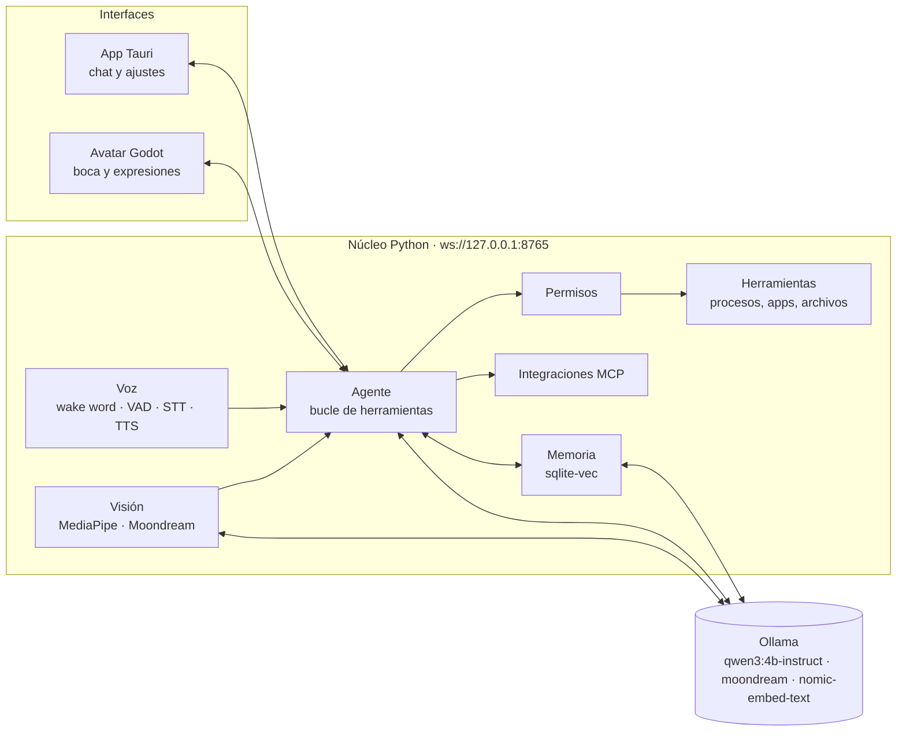

# Arquitectura

## Principios

1. **Todo local.** Ningún dato sale de la PC. La nube es opcional y llegaría después (respaldo, acceso desde el celular).
2. **Todo open source.** Cada dependencia y modelo se registra en [licencias.md](licencias.md) antes de entrar al proyecto.
3. **Permisos por niveles.** El asistente nunca cierra, borra, ejecuta ni envía algo sin confirmación.
4. **Piezas reemplazables.** Cada capa (LLM, voz, visión, avatar) se comunica por mensajes, así se puede cambiar un modelo sin tocar el resto.

## Capas

| Capa | Carpeta | Tecnología | Sprint |
|---|---|---|---|
| App de escritorio | `app/` | Tauri 2, React, TypeScript, Tailwind | S1 |
| Agente y LLM | `core/.../agent` | Ollama + Qwen3 4B, tool calling | S1 |
| Herramientas | `core/.../tools` | psutil, pywinauto | S2 |
| Permisos | `core/.../permissions` | niveles `libre` / `confirmar` / `prohibido` | S2 |
| Voz | `core/.../voice` | openWakeWord, Silero VAD, faster-whisper, Piper | S3 |
| Avatar | `avatar/` | Godot 4 (ventana transparente) | S4 |
| Visión | `core/.../vision` | OpenCV, MediaPipe, Moondream | S5 |
| Memoria | `core/.../memory` | sqlite-vec, nomic-embed-text | S6 |
| Integraciones | `core/.../integrations` | MCP, Playwright | S7 |
| Instalador | `app/src-tauri` | bundler de Tauri + núcleo empaquetado con PyInstaller | S8 |

## Comunicación

El núcleo expone un WebSocket en `ws://127.0.0.1:8765/ws` (solo localhost). Mensajes JSON:

| Dirección | Mensaje | Uso |
|---|---|---|
| app → núcleo | `{"type": "chat", "text": "..."}` | pregunta del usuario |
| núcleo → app | `{"type": "token", "text": "..."}` | fragmento de respuesta (streaming) |
| núcleo → app | `{"type": "done"}` | fin de la respuesta |
| núcleo → app | `{"type": "error", "message": "..."}` | algo falló |

Pendiente en S4: un canal de eventos compartido (`estado`: escuchando / pensando / hablando, y `viseme` para la boca) que el núcleo envíe a todas las conexiones, para que el avatar reaccione a lo que pasa en la app.

## Presupuesto de memoria (RTX 3050 Ti, 4 GB VRAM)

| Pieza | Dónde | Aprox. |
|---|---|---|
| qwen3:4b-instruct (Q4) | GPU | 2.5–3 GB VRAM |
| moondream | GPU, solo bajo demanda | ~1.7 GB VRAM (Ollama descarga el LLM mientras tanto) |
| faster-whisper small (int8) | CPU | ~0.5 GB RAM |
| Piper | CPU | ~0.1 GB RAM |
| MediaPipe | CPU | ~0.2 GB RAM |
| nomic-embed-text | GPU/CPU | ~0.3 GB |

Regla: nunca dos modelos grandes en la GPU a la vez.
