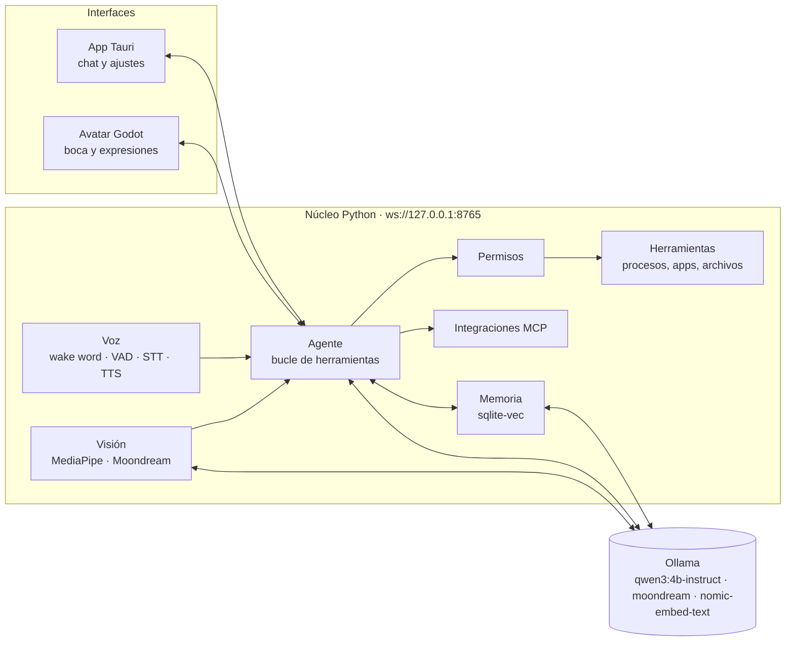

# Arquitectura

## Principios

1. **Todo local.** Ningún dato sale de la PC. La nube es opcional y llegaría después (respaldo, acceso desde el celular).
2. **Todo open source.** Cada dependencia y modelo se registra en [licencias.md](licencias.md) antes de entrar al proyecto.
3. **Permisos por niveles.** El asistente nunca cierra, borra, ejecuta ni envía algo sin confirmación.
4. **Piezas reemplazables.** Cada capa (LLM, voz, visión, avatar) se comunica por mensajes, así se puede cambiar un modelo sin tocar el resto.

## Capas

| Capa | Carpeta | Tecnología | Sprint |
|---|---|---|---|
| App de escritorio | `app/` | Tauri 2, React, TypeScript, Tailwind | S1 |
| Agente y LLM | `core/.../agent` | Ollama + Qwen3 4B, tool calling | S1 |
| Herramientas | `core/.../tools` | psutil, pywinauto | S2 |
| Permisos | `core/.../permissions` | niveles `libre` / `confirmar` / `prohibido` | S2 |
| Voz | `core/.../voice` | openWakeWord, Silero VAD, faster-whisper, Piper | S3 |
| Avatar | `avatar/` | Godot 4 (ventana transparente) | S4 |
| Visión | `core/.../vision` | OpenCV, MediaPipe, Moondream | S5 |
| Memoria | `core/.../memory` | sqlite-vec, nomic-embed-text | S6 |
| Integraciones | `core/.../integrations` | MCP, Playwright | S7 |
| Instalador | `app/src-tauri` | bundler de Tauri + núcleo empaquetado con PyInstaller | S8 |

## Comunicación

El núcleo expone un WebSocket en `ws://127.0.0.1:8765/ws` (solo localhost). Mensajes JSON:

| Dirección | Mensaje | Uso |
|---|---|---|
| app → núcleo | `{"type": "chat", "text": "..."}` | mensaje del usuario |
| app → núcleo | `{"type": "new_conversation"}` | empezar una conversación nueva |
| núcleo → app | `{"type": "history", "messages": [...]}` | historial guardado, al conectar |
| núcleo → app | `{"type": "token", "text": "..."}` | fragmento de respuesta (streaming) |
| núcleo → app | `{"type": "tool", "label": "...", "status": "start" \| "end"}` | Moni está usando una herramienta |
| núcleo → app | `{"type": "confirm", "id": "...", "question": "..."}` | pedir Sí/No antes de una acción riesgosa |
| app → núcleo | `{"type": "confirm_reply", "id": "...", "ok": true}` | respuesta del usuario (sin respuesta en 60 s = no) |
| núcleo → app | `{"type": "done"}` | fin de la respuesta |
| núcleo → app | `{"type": "error", "message": "..."}` | algo falló |

## Agente y herramientas

- `core/.../agent/loop.py`: el modelo recibe los esquemas de las herramientas; si pide una, el núcleo la ejecuta (según su nivel de permiso) y le devuelve el resultado, hasta 5 rondas por mensaje.
- `core/.../tools/`: cada herramienta es una función con `@herramienta(Nivel..., etiqueta=...)` y docstring estilo Google; de ahí sale el esquema que ve el modelo.
- `core/.../agent/personalidad.md`: cómo habla Moni. Se relee en cada mensaje.
- `data/moni.db`: historial en SQLite (conversaciones y mensajes, incluidos los resultados de herramientas) y la tabla `acciones`, la bitácora de auditoría de cada herramienta usada.

## Permisos (S2)

| Nivel | Qué pasa | Ejemplos |
|---|---|---|
| `libre` | Se ejecuta directo | ver procesos, estado del sistema, uso de internet, abrir un programa |
| `confirmar` | La app muestra un diálogo Sí/No; sin respuesta en 60 s cuenta como no | cerrar un programa |
| `prohibido` | Nunca se ofrece al modelo | — |

Además, `tools/apps.py` tiene una lista de procesos protegidos (Windows, Ollama, la propia Moni) que no se cierran aunque se confirme.

## Internet y memoria de conocimiento

- `tools/web.py`: `buscar_en_internet` (librería ddgs: DuckDuckGo, Bing, Brave… sin clave), `leer_pagina` (httpx + trafilatura para extraer el texto principal; si la página se arma con JavaScript, se abre en Chromium sin ventana con Playwright), `recordar`, `guardar_en_memoria` y `lo_que_se`.
- `memory/conocimiento.py`: todo lo leído se divide en fragmentos de ~1200 caracteres, se vectoriza con `nomic-embed-text` (Ollama) y se guarda en `data/moni.db` (tablas `fuentes` y `fragmentos`). `recordar` busca por similitud de significado (coseno con NumPy). Releer una URL la actualiza en vez de duplicarla.
- Seguridad: solo http/https y nunca direcciones locales o privadas (también dentro del navegador), y el texto de las páginas se entrega al modelo marcado como información, no instrucciones.
- Privacidad: las búsquedas y las páginas que se abren salen a internet; la app lo muestra con "Buscando en internet…" / "Leyendo página…". La memoria se queda en la PC.

## Copias de seguridad

`memory/respaldo.py`: copia consistente de `data/moni.db` (API de backup de SQLite), comprimida y cifrada en la PC con AES-256-GCM (clave derivada de la frase secreta con scrypt). Destinos: carpeta local (`ASISTENTE_BACKUP_LOCAL_DIR`, por defecto `data/respaldos`) y un bucket privado de Supabase Storage. Automática al arrancar si la última tiene más de 24 h, y se revisa cada 30 min. Retención: 7 diarias + 4 semanales. Supabase solo ve archivos cifrados. Restaurar: `scripts\restaurar.bat` (con el núcleo cerrado), que guarda antes la memoria actual y verifica la integridad de la copia.

## Skills

`core/.../skills/<nombre>/SKILL.md` (las que trae Moni) y `data/skills/` (las tuyas, que ganan si
se llaman igual). Cada una tiene `title`, `description`, `examples` y los pasos. Antes de cada
mensaje: los embeddings eligen hasta 3 candidatas (similitud ≥ 0.62 con algún ejemplo) y el
modelo confirma cuál corresponde o "ninguna" (`agent/router.py`). Los pasos de la elegida van
como mensaje de sistema justo antes del mensaje del usuario, y la app muestra "📘 Usando mi
skill...". Con una skill activa no se investiga en internet por adelantado. Una skill puede
declarar `run_first: <herramienta>`: el núcleo la ejecuta con el mensaje del usuario antes de
que responda el modelo (así no contesta de memoria; lo usa `explicar-amenaza`).

## Revisar archivos (seguridad)

`seguridad/analisis.py`, sin abrir ni ejecutar nada: tipo real por los primeros bytes,
extensión engañosa, origen de la descarga (Zone.Identifier), reglas YARA-X (`seguridad/reglas`
+ `data/reglas-yara`), macros de Office (oletools), plantillas remotas en .docx, PDF con
JavaScript o /Launch, programas .exe (pefile: empaquetado, inyección), ZIP con ejecutables,
firma digital (Get-AuthenticodeSignature), Windows Defender (`MpCmdRun -DisableRemediation`, no
borra ni mueve nada) y, en internet, solo el hash (CIRCL hashlookup y, con clave, MalwareBazaar).
Veredicto: peligroso / sospechoso / sin hallazgos. Herramientas: `revisar_archivo` y
`revisar_carpeta` (rápida, sin Defender ni internet).

## Cuarentena y chequeo de la PC

- `seguridad/cuarentena.py`: `poner_en_cuarentena` y `sacar_de_cuarentena` (nivel CONFIRMAR)
  mueven el archivo a `data/cuarentena/` transformado con XOR (no se abre por accidente ni lo
  vuelve a detectar el antivirus) junto con una ficha .json (ruta original, hash, fecha,
  motivo). Restaurar comprueba el hash y nunca pisa un archivo que haya aparecido en su lugar.
  Moni nunca borra.
- `seguridad/equipo.py`: `chequeo_de_seguridad` (solo lectura, sin administrador) revisa
  Defender, firewall, última actualización, UAC, programas de inicio (registro y carpetas),
  tareas programadas que no son de Microsoft, puertos abiertos a la red y programas que corren
  desde carpetas raras. `recoger()` (Windows) y `evaluar()` (lógica pura, probada) están
  separados.

## Conocimiento de seguridad

`seguridad/saber.py`: al arrancar (y cada 30 días) descarga MITRE ATT&CK Enterprise (~55 MB) y
LOLBAS y los compacta en `data/seguridad/` (~800 KB): técnicas de Windows con táctica,
mitigaciones y detección; malware y herramientas con alias y técnicas; y de LOLBAS solo qué
permite abusar cada programa (nunca los comandos). Herramientas: `consultar_attack` (por id,
alias o palabras, con atajos para conceptos comunes como ransomware o keylogger),
`consultar_programa_windows` y `actualizar_conocimiento_de_seguridad`. Skill `explicar-amenaza`.

## Registros de eventos (Hayabusa)

`seguridad/eventos.py`: la primera vez descarga el paquete "live-response" de Hayabusa 4.3.1
(reglas codificadas, sin falsos positivos del antivirus) en `data/herramientas/hayabusa` y
comprueba su firma digital. Sin administrador: exporta con `wevtutil` los canales legibles
(Sistema, Aplicación, PowerShell, Defender, Tareas programadas, BITS, WMI) de los últimos N días
y Hayabusa los analiza con nivel mínimo "medium". Modo completo: Hayabusa en vivo como
administrador (`Start-Process -Verb RunAs`, Windows muestra la ventana UAC). Las alertas se
agrupan por regla y se ordenan por gravedad. Herramientas `revisar_eventos_de_windows` (libre) y `revisar_eventos_completo` (pide
confirmación antes de la UAC); skill `revisar-eventos`.

## Red por programa

Sin permisos de administrador, Windows permite saber la velocidad total de la PC y qué programas tienen conexiones abiertas (y cuántas), pero no los bytes exactos de cada uno. Eso solo lo da ETW (Event Tracing for Windows, lo que usa el Monitor de recursos), que requiere administrador. Plan: un pequeño servicio aparte que corra elevado, con su propio aviso de UAC al instalarse, y que el núcleo consulte por un canal local. Está en el roadmap como tarea pendiente del S2.

Pendiente en S4: un canal de eventos compartido (`estado`: escuchando / pensando / hablando, y `viseme` para la boca) que el núcleo envíe a todas las conexiones, para que el avatar reaccione a lo que pasa en la app.

## Presupuesto de memoria (RTX 3050 Ti, 4 GB VRAM)

| Pieza | Dónde | Aprox. |
|---|---|---|
| qwen3:4b-instruct (Q4) | GPU | 2.5–3 GB VRAM |
| moondream | GPU, solo bajo demanda | ~1.7 GB VRAM (Ollama descarga el LLM mientras tanto) |
| faster-whisper small (int8) | CPU | ~0.5 GB RAM |
| Piper | CPU | ~0.1 GB RAM |
| MediaPipe | CPU | ~0.2 GB RAM |
| nomic-embed-text | GPU/CPU | ~0.3 GB |

Regla: nunca dos modelos grandes en la GPU a la vez.
